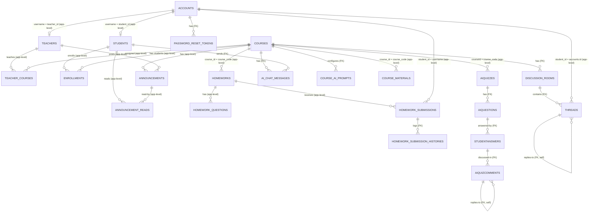

# Database 文件

> 所屬文件：[overview.md（總覽）](overview.md) ・ **database.md** ・ [process-issues.md](process-issues.md) ・ [workflow.md](workflow.md) ・ [modules/](modules/README.md)
>
> 內容依 `backend/scripts/initDB.js`、`backend/src/utils/ensureSchema.js`、`backend/src/models/*.js` 實際程式碼整理（核對日期：2026-09-27）。

---

## 1. 基本資訊

| 項目 | 內容 |
| --- | --- |
| 資料庫 | MySQL |
| 連線方式 | `mysql2/promise` 連線池（`backend/src/config/db.js`，`connectionLimit: 10`） |
| 連線設定 | `.env`：`DB_HOST`（預設 `localhost`）、`DB_USER`（預設 `root`）、`DB_PASSWORD`、`DB_NAME`（預設 `classroom_data`） |
| 建表腳本 | `backend/scripts/initDB.js`（可重複執行） |
| 啟動時補欄位 | `backend/src/utils/ensureSchema.js`（`server.js` 啟動前呼叫） |
| Migration 工具 | **無**（沒有 Knex / Prisma / Flyway） |

### 1.1 建表方式

- `initDB.js`：`CREATE TABLE IF NOT EXISTS` + 一連串包在 `try/catch` 裡的 `ALTER TABLE ... ADD COLUMN`，欄位已存在時錯誤會被忽略，因此**可重複執行**。這是目前唯一應該使用的建表方式。
- `initDB.js` **不會** `CREATE DATABASE`，資料庫本身需先手動建立（例如 `CREATE DATABASE classroom_data;`）。
- `ensureSchema.js`：伺服器啟動時補上 `homework_submissions.is_submitted`、`accounts.must_change_password`、`accounts.avatar_url` 三個欄位，與 `initDB.js` 內容重複。
- `db/create_db.py`、`db/seed_data.py`：**舊版 Python 腳本，不要使用**（見 [第 5 節](#5-舊版腳本)）。

> ⚠️ 所有 schema 變更都是手動疊加 `ALTER TABLE`，且分散在 `initDB.js` 與 `ensureSchema.js` 兩處。新增欄位的寫法見 [第 6 節](#6-修改資料庫時的規範)。

---

## 2. 鍵值慣例(最容易踩雷的地方)

同樣是「課程」或「使用者」，不同資料表存的鍵值不同：

| 概念 | 代理鍵（數字 id） | 自然鍵（字串） |
| --- | --- | --- |
| 課程 | `courses.id` | `courses.course_code` |
| 使用者 | `accounts.id` / `students.id` / `teachers.id` | `accounts.username`（= `students.student_id` = `teachers.teacher_id`） |

各表實際使用的鍵：

| 欄位 | 實際存的值 |
| --- | --- |
| `teacher_courses.course_id`、`enrollments.course_id`、`announcements.course_id`、`discussion_rooms.course_id`、`ai_chat_messages.course_id`、`course_ai_prompts.course_id` | `courses.id` |
| `homeworks.course_id`（VARCHAR）、`course_materials.course_id`（VARCHAR）、`AIQuizzes.courseId` | **`courses.course_code`** |
| `enrollments.student_id`、`announcement_reads.student_id`、`ai_chat_messages.student_id` | `students.id` |
| `teacher_courses.teacher_id`、`announcements.teacher_id` | `teachers.id` |
| `homework_submissions.student_id`、`course_materials.uploader_id`、`AIQuizzes.teacherId`、`StudentAnswers.studentId`、`AIQuizComments.userId` | **`accounts.username`** |
| `threads.student_id`（VARCHAR） | **`accounts.id`（數字轉字串）或字面值 `'AI'`** |

> ⚠️ 已有程式碼因此出錯，詳見 [第 7 節](#7-已知問題)。

---

## 3. Table 總覽

「FK」欄標示該關聯是 **DB 層有 FOREIGN KEY 約束**，或 **僅應用程式邏輯關聯（app-level）**。

### 3.1 帳號 / 使用者

| Table | 用途 | 欄位 | PK | FK |
| --- | --- | --- | --- | --- |
| `accounts` | 登入帳號 | `username` VARCHAR(50) UNIQUE、`password_hash`、`email`、`role`（`student`/`teacher`/`ta`）、`must_change_password` TINYINT、`avatar_url`、`created_at` | `id` | 無 |
| `students` | 學生資料（**`ta` 也寫入此表**） | `name`、`student_id` UNIQUE（= `accounts.username`） | `id` | app-level → `accounts.username` |
| `teachers` | 教師資料 | `name`、`teacher_id` UNIQUE（= `accounts.username`） | `id` | app-level → `accounts.username` |
| `password_reset_tokens` | Email 重設密碼 token（**目前沒有產生流程**，見 [auth 模組已知問題](modules/auth.md)、[overview.md 11.4](overview.md#114-安全機制)） | `account_id`、`token_hash` CHAR(64)、`expires_at`、`used_at`、`created_at` | `id` | `account_id` → `accounts.id`（FK, CASCADE） |

### 3.2 課程 / 選課

| Table | 用途 | 欄位 | PK | FK |
| --- | --- | --- | --- | --- |
| `courses` | 課程主檔 | `course_name`、`course_code` UNIQUE、`description`、`academic_year`、`created_at` | `id` | 無 |
| `teacher_courses` | 授課關聯 | `teacher_id`、`course_id` | `id` | **無 FK**（app-level → `teachers.id` / `courses.id`） |
| `enrollments` | 選課關聯 | `student_id`、`course_id` | `id` | **無 FK**（app-level → `students.id` / `courses.id`） |

### 3.3 公告

| Table | 用途 | 欄位 | PK | FK |
| --- | --- | --- | --- | --- |
| `announcements` | 課程公告 | `course_id`、`teacher_id`、`title`、`content`、`is_pinned`、`created_at` | `id` | **無 FK**（app-level → `courses.id` / `teachers.id`） |
| `announcement_reads` | 已讀紀錄 | `student_id`、`announcement_id`；UNIQUE(`student_id`, `announcement_id`) | `id` | **無 FK**（app-level → `students.id` / `announcements.id`） |

> 助教發公告時，`teacher_id` 會寫入「該課程第一位授課教師」的 `teachers.id`（助教不在 `teachers` 表）。

### 3.4 作業

| Table | 用途 | 欄位 | PK | FK |
| --- | --- | --- | --- | --- |
| `homeworks` | 作業主檔 | `course_id` VARCHAR(50)（**存 `course_code`**）、`title`、`description`、`deadline`、`attachments_json` TEXT（ALTER 加入，JSON 陣列 `[{file_name, file_path}]`） | `id` | **無 FK** |
| `homework_questions` | 作業子題 | `homework_id`、`question_order`、`title`、`description`、`answer_format`（`file`/`text`）、`discussion_prompt`（解惑 Prompt）、`ai_prompt`（ALTER 加入，語意為**評分 Prompt**）、`has_attachment`、`file_name`、`file_path` | `id` | **無 FK**（app-level → `homeworks.id`） |
| `homework_submissions` | 繳交紀錄 | `homework_id`、`student_id` VARCHAR(128)（**存 `accounts.username`**）、`answer_text`（JSON 字串陣列）、`file_name`、`file_path`、`score` VARCHAR(10)、`feedback`、`graded_details` TEXT（ALTER 加入，存 JSON 字串）、`is_submitted`、`submitted_at`、`graded_at`；UNIQUE(`homework_id`, `student_id`) | `id` | **無 FK** |
| `homework_submission_histories` | 繳交事件歷程 | `submission_id`、`event_type`（`submit` / `unsubmit` / `teacher_grade` / `ai_suggestion` / `student_self_estimate`）、`payload_json` LONGTEXT、`created_at` | `id` | `submission_id` → `homework_submissions.id`（FK, CASCADE） |

> ⚠️ **`homework_submissions.ai_estimated_score` / `ai_estimated_reason` / `ai_estimated_at` 三個欄位不存在於任何建表或補欄位腳本**，但 `homeworkAiController.js` 的 4 支 AI 評分 API 都會 `UPDATE` 這三欄，`homeworkService.getSubmissionHistory` 也會讀取。全新環境跑完 `initDB.js` 後，這些 API 會因 `Unknown column` 失敗。需與團隊確認既有資料庫是如何加上這三欄，並補進 `initDB.js`。

### 3.5 討論區

| Table | 用途 | 欄位 | PK | FK |
| --- | --- | --- | --- | --- |
| `discussion_rooms` | 討論主題 | `course_id`、`room_name`（建表時存在，程式碼未使用）、`title`、`content`（ALTER）、`ai_prompt`（ALTER）、`file_path`（ALTER，存 `uploads/xxx.pdf`，**沒有**開頭斜線）、`created_at` | `id` | `course_id` → `courses.id`（FK, CASCADE） |
| `threads` | 留言（巢狀） | `room_id`、`student_id` VARCHAR(50)（**存 `accounts.id` 或 `'AI'`**）、`content`、`parent_thread_id`、`created_at` | `id` | `room_id` → `discussion_rooms.id`；`parent_thread_id` → `threads.id`（皆 FK, CASCADE） |

### 3.6 AI 助教 / Prompt 設定

| Table | 用途 | 欄位 | PK | FK |
| --- | --- | --- | --- | --- |
| `ai_chat_messages` | 課程 AI 助教聊天紀錄 | `course_id`、`student_id`、`role` ENUM(`user`,`assistant`)、`message`、`created_at` | `id` | `course_id` → `courses.id`；`student_id` → `students.id`（皆 FK, CASCADE） |
| `course_ai_prompts` | 每門課的 Prompt 與資料存取開關 | `course_id`、`chat_prompt`、`discussion_prompt`（ALTER）、`grading_prompt`（ALTER）、`send_announcements` / `send_assignments` / `send_student_info` / `send_grades`（ALTER，BOOLEAN）、`updated_at` | `id` | `course_id` → `courses.id`（FK, CASCADE） |

> 建立課程時會在同一個 transaction 內插入一筆預設 Prompt（三種 Prompt 內容相同）。

### 3.7 教材

| Table | 用途 | 欄位 | PK | FK |
| --- | --- | --- | --- | --- |
| `course_materials` | 教材清單 | `course_id` VARCHAR(50)（**存 `course_code`**）、`uploader_id`（存 `accounts.username`）、`file_name`、`file_path`、`created_at` | `id` | **無 FK** |

### 3.8 AI 測驗

| Table | 用途 | 欄位 | PK | FK |
| --- | --- | --- | --- | --- |
| `AIQuizzes` | 測驗主檔 | `courseId`（存 `course_code`）、`teacherId`（存 `accounts.username`）、`title`、`sourceFile`、`deadline`、`createdAt` | `id` VARCHAR（UUID） | **無 FK** |
| `AIQuestions` | 測驗題目 | `quizId`、`questionText`、`discussionPrompt` | `id`（UUID） | `quizId` → `AIQuizzes.id`（FK, CASCADE） |
| `StudentAnswers` | 作答與 AI 回饋 | `questionId`、`studentId`（存 `accounts.username`）、`studentName`、`answerText`、`aiFeedback`（ALTER）、`submitTime` | `id`（UUID） | `questionId` → `AIQuestions.id`（FK, CASCADE） |
| `AIQuizComments` | 作答下的巢狀留言 | `answerId`、`parentId`、`userId`、`userName`、`role`、`content`、`createdAt` | `id`（UUID） | `answerId` → `StudentAnswers.id`；`parentId` → `AIQuizComments.id`（皆 FK, CASCADE） |

> ⚠️ `StudentAnswers` 沒有 UNIQUE(`questionId`, `studentId`)，而 `id` 每次都是新 UUID，所以 `saveStudentAnswer` 裡的 `ON DUPLICATE KEY UPDATE` 永遠不會觸發：**同一位學生重新作答會新增一筆，而不是覆蓋**。

---

## 4. ER Diagram

標註 `app-level` 的關係在 DB 層沒有 FOREIGN KEY 約束；標註 `FK` 的有。



### 刪除連動

| 動作 | 連動結果 |
| --- | --- |
| 刪除作業（`HomeworkService.deleteHomework`） | 程式碼依序刪除 `homework_submissions` → `homework_questions` → `homeworks`；`homework_submission_histories` 由 FK CASCADE 刪除 |
| 刪除討論主題 | `threads` 由 FK CASCADE 刪除；**附件 PDF 實體檔不會刪除** |
| 刪除 AI 測驗 | `AIQuestions` → `StudentAnswers` → `AIQuizComments` 由 FK CASCADE 刪除；**來源 PDF 實體檔不會刪除** |
| 刪除教材 | 程式碼會先刪除實體檔，再刪除資料列 |
| 刪除作業 | **附件與學生上傳檔案實體檔不會刪除** |

---

## 5. 舊版腳本

| 檔案 | 狀態 |
| --- | --- |
| `db/create_db.py` | 舊版建表腳本，欄位與 `initDB.js` 已有落差（缺 `must_change_password`、`avatar_url`、AI 相關表與欄位）。**不要使用。** |
| `db/seed_data.py` | 舊版測試資料。密碼用 `werkzeug.generate_password_hash` 產生，**與後端使用的 bcryptjs 不相容，種子帳號無法登入**。 |
| `db/db.md`、`db/image/mermaid-diagram.png` | 舊版說明與 ER 圖，已過時。 |

> ⚠️ `create_db.py`、`seed_data.py` 內含**寫死的明文 MySQL 密碼**，且已進入 git 歷史。建議更換該密碼、移除硬編碼，並評估是否清理 git 歷史。

---

## 6. 修改資料庫時的規範

1. **不要**修改或 DROP 既有的 `CREATE TABLE`。新增欄位一律在 `backend/scripts/initDB.js` 尾端加一段：
   ```js
   try {
       await pool.execute("ALTER TABLE <table> ADD COLUMN <column> <type>");
   } catch (e) { /* 欄位已存在就忽略 */ }
   ```
   確保腳本可在既有資料庫上重複執行。
2. 若欄位是「程式已在用但 schema 沒有」的（例如 `ai_estimated_*`），請優先補齊並更新本文件。
3. 新增存「課程」或「使用者」的欄位前，先看 [第 2 節](#2-鍵值慣例最容易踩雷的地方)，與同模組既有欄位保持一致，不要再引入新的鍵值慣例。
4. 新增表格 / 欄位後，同步更新本文件第 3、4 節。

---

## 7. 已知問題

| 優先度 | 問題 | 說明 |
| --- | --- | --- |
| High | `ai_estimated_*` 三欄未建立 | 見 3.4。 |
| High | 課程層級 Prompt 在作業 AI 功能中讀不到 | `homeworkAiService` 用 `hw.course_id`（`course_code` 字串）去查 `course_ai_prompts.course_id`（`courses.id` 數字），條件對不上，因此作業 AI 評分 / 解惑時的「課程評分提示」「課程討論提示」實際上是空字串。 |
| High | AI 助教的「作業」「學生資訊」資料讀不到 | `courseAiService.askAssistant`：`send_assignments` 用 `courses.id` 查 `homeworks.course_id`（存 `course_code`）；`send_student_info` 用 `students.id` 查 `homework_submissions.student_id`（存 username）、用 `courses.id` 查 `homeworks.course_id`。結果恆為空或錯誤。`send_grades` 與 `remindHomework` 使用的鍵正確。 |
| Medium | 多數關聯沒有 FK | `teacher_courses`、`enrollments`、`announcements`、`announcement_reads`、`homeworks`、`homework_questions`、`homework_submissions`、`course_materials`、`AIQuizzes` 無 FK，孤兒資料不會被擋下。補 FK 前需先統一鍵值策略。 |
| Medium | 自然鍵 / 代理鍵混用 | 見第 2 節。長期建議統一使用數字 id，在 API 層轉換。 |
| Medium | `StudentAnswers` 缺 UNIQUE | 見 3.8。需確認「保留歷次作答」還是「覆蓋」才是預期行為。 |
| Medium | `upsertPrompts` 的 INSERT 分支錯誤 | `courseAiModel.upsertPrompts` 在「該課程還沒有 Prompt 列」時，INSERT 寫入的是 `course_code` 而非 `courses.id`，且漏掉 `send_grades`。正常流程建課時已插入一列，所以通常走 UPDATE 分支。 |
| Low | 命名與語意不符 | `homework_questions.ai_prompt` 實為評分 Prompt；`threads.student_id` 實為 `accounts.id`。 |
| Low | 未使用欄位 | `discussion_rooms.room_name`、`homework_questions.has_attachment / file_name / file_path`（建立作業時固定寫 0 / NULL）。 |
| Low | 上傳檔案沒有清理 | 見第 4 節「刪除連動」。 |
