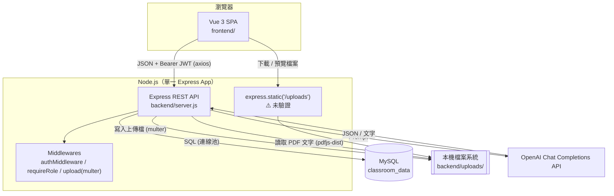
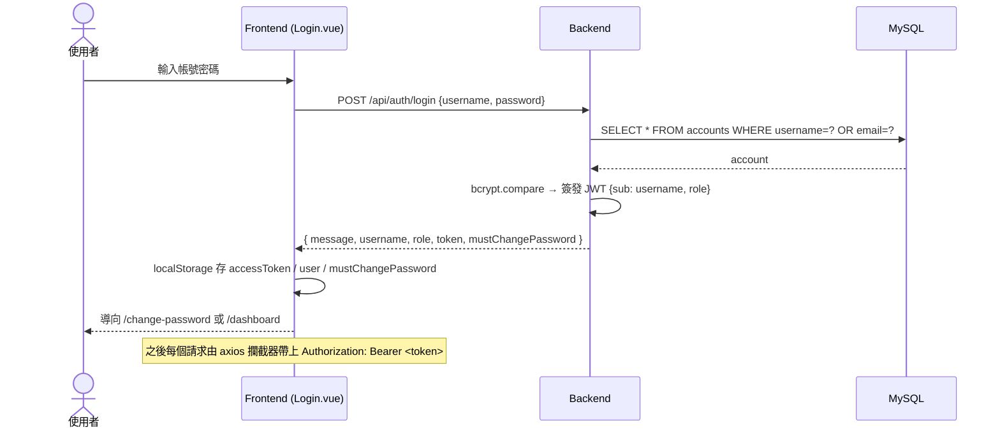
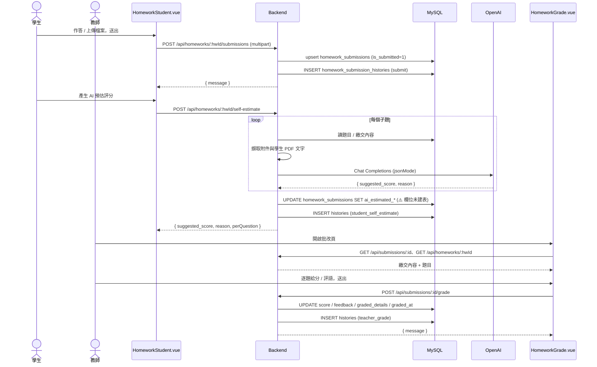
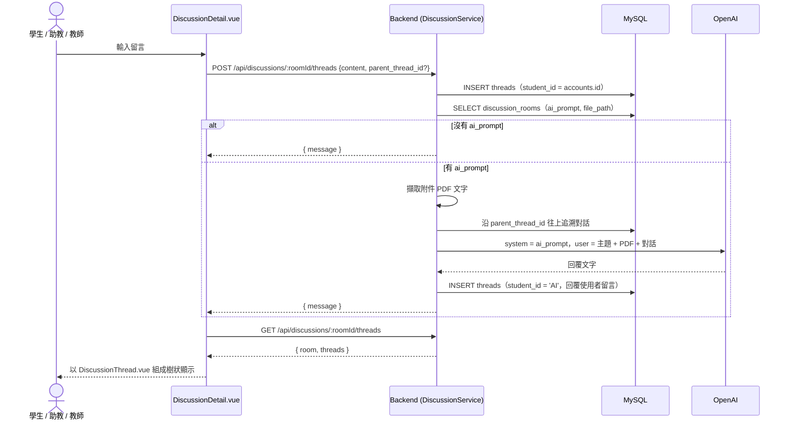
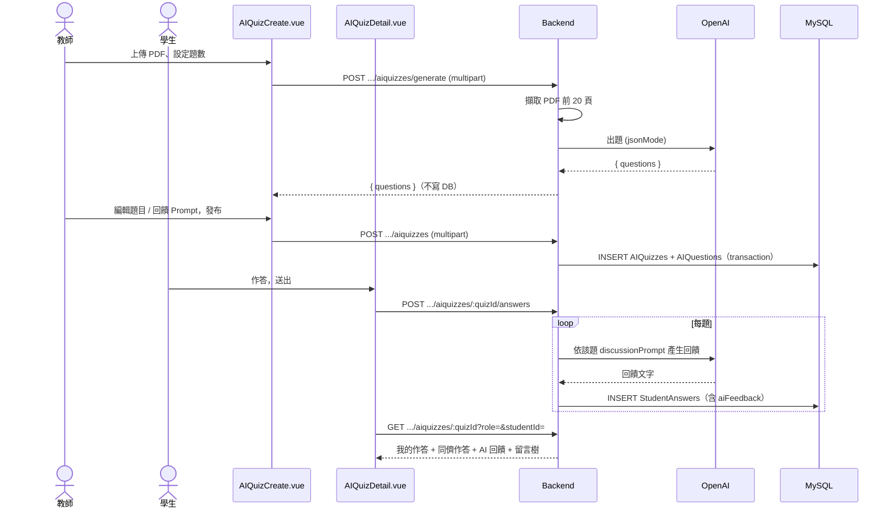
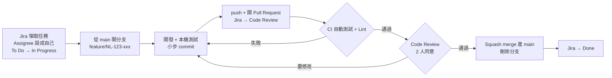

# 系統文件(總覽)

> 給加入本專案的同伴們閱讀，用來快速理解系統現況，並作為開發時的共同規格。
>
> 核對日期：**2026-09-27**。無法從程式碼確認的地方會標示 **TODO / 待確認**。

| 文件 | 內容 |
| --- | --- |
| **overview.md**（本文件） | 系統概述、架構、跨層資料流程、部署、環境變數、開發流程、問題總表 |
| [modules/](modules/README.md) | **依模組拆分**的頁面/API/資料表對照，每個模組一個檔案，附前後端程式碼的檔案＋函式名稱（見下方模組索引） |
| [database.md](database.md) | MySQL：資料表、鍵值慣例、ER 圖、建表方式、DB 已知問題 |
| [process-issues.md](process-issues.md) | 依 git 歷史稽核出的流程現況問題（版控協作、測試、CI、Schema 管理、機密、文件、部署） |
| [workflow.md](workflow.md) | 團隊**正式採用、必須遵守**的開發流程規則（Jira/Discord/GitHub 工作流程、程式規範、PR/Review/部署） |


### 模組索引

| 模組 | 涵蓋範圍 |
| --- | --- |
| [auth](modules/auth.md) | 註冊、登入、忘記密碼、改密碼、頭貼 |
| [course](modules/course.md) | 課程搜尋、加選課、建立課程 |
| [announcement](modules/announcement.md) | 課程公告與已讀狀態 |
| [material](modules/material.md) | 課程教材上傳/下載/刪除 |
| [discussion](modules/discussion.md) | 討論區主題、巢狀留言、AI 自動回覆 |
| [homework](modules/homework.md) | 作業 CRUD、繳交、收回、批改、歷程 |
| [homework-ai](modules/homework-ai.md) | 作業 AI 預評分、AI 解惑聊天、課程 Prompt 設定 |
| [course-ai](modules/course-ai.md) | 課程 AI 助教聊天、作業提醒、聊天紀錄 |
| [aiquiz](modules/aiquiz.md) | AI 出題、學生作答、AI 即時回饋、留言 |
| [shared](modules/shared.md) | 不屬於單一模組的共用基礎設施 |

---

## 1. 系統概述

此系統是中央大學 LMS 開發小組開發的課程管理系統（LMS），目標是**取代校內現行的 eeclass 系統**，而非獨立的示範／學習用專案。這代表：

- 最終使用者是全校實際修課的師生，資料（成績、作業、討論內容）是真實且需要長期保存的，不是測試資料。
- 安全性與資料正確性相關的問題（見第 9 章、各分冊「已知問題」）在正式上線前都需要被視為必須處理的項目，而非「demo 可接受」的技術債。
- 正式對外名稱待定。

### 1.1 功能現況

| 功能 | 前端 | 後端 |
| --- | --- | --- |
| 註冊 / 登入 / 強制改密碼 / 頭貼 | ✅ | ✅ |
| 忘記密碼（教師提供的重設代碼） | ✅ | ✅ |
| 忘記密碼（Email 連結） | 頁面存在 | ⚠️ 未完成：沒有產生 token、寄信的 API |
| 課程建立、搜尋、加選 | ✅ | ✅（助教無法建立課程） |
| 課程公告（含已讀狀態） | ✅ | ✅ |
| 課程教材上傳 / 下載 / 刪除 | ✅ | ✅ |
| 作業發布、編輯、繳交、收回、批改、歷程 | ✅ | ✅ |
| 作業 AI 預估評分（學生自評） | ✅ | ✅ |
| 作業 AI 預評分（教師單題 / 整份 / 批次） | ❌ 沒有入口 | ✅ |
| 作業 AI 解惑聊天（蘇格拉底式） | ✅ | ✅ |
| 討論區 + AI 自動回覆（可讀附件 PDF 與對話串） | ✅ | ✅ |
| 課程 AI 助教聊天 + 作業提醒（學生） | ✅（只在公告頁） | ✅ |
| 課程 AI Prompt 設定（教師 / 助教） | ✅（只在公告頁） | ✅ |
| AI 測驗：PDF 出題 → 作答 → AI 回饋 → 同儕留言 | ✅ | ✅ |
| 考試（Exam） | ⚠️ 佔位頁 | ❌ |
| 成績總表 / 權重（Grade） | ⚠️ 佔位頁（假資料） | ❌ |

### 1.2 使用者角色

角色存於 `accounts.role`，註冊時可選三種：

| 角色 | 說明 | 資料表 |
| --- | --- | --- |
| `student` | 選課、繳交作業、參與討論、AI 測驗、AI 助教 | `students` |
| `teacher` | 建立課程、發布公告 / 作業 / 測驗、批改、設定 AI Prompt | `teachers` |
| `ta` | 助教。**沒有自己的資料表，寫入 `students`**。同時具備大部分學生端與教師端權限，但無法建立課程；前端 ChatBot 對助教只顯示 Prompt 設定，不顯示聊天 | `students` |

角色權限細節見 [第 11.3 節](#113-驗證與授權)。

---

## 2. 系統架構

- **Frontend**：Vue 3 SPA（Vite），透過 axios 呼叫 REST API，JWT 存於 localStorage。
- **Backend**：Node.js + Express 5，分層為 Route → Controller → Service → Model。
- **Database**：MySQL（`mysql2/promise` 連線池）。
- **AI**：OpenAI Chat Completions API（預設 `gpt-4o-mini`），後端以原生 `fetch` 呼叫。
- **檔案**：存在後端本機 `backend/uploads/`，multer 處理上傳，`express.static` 對外提供。



### 2.1 技術總覽

| 層級 | 技術 |
| --- | --- |
| Frontend | Vue 3、Vite 7、vue-router 5、axios、Tailwind CSS 3、marked；無狀態管理套件 |
| Backend | Node.js（ESM）、Express 5、mysql2、jsonwebtoken、bcryptjs、multer、pdfjs-dist + canvas、nodemailer、uuid |
| Database | MySQL |
| AI | OpenAI Chat Completions REST API |
| 測試 | **無** |
| CI/CD | **無**（沒有 `.github/workflows`） |

---

## 3. 專案結構

```text
eeclass/
├── frontend/            # Vue 3 前端（獨立子專案）→ 目錄細節見第 11.5 節
├── backend/             # Express 後端（獨立子專案）→ 目錄細節見第 11.1 節
│   ├── scripts/initDB.js  # 建表腳本 → 見 database.md
│   └── uploads/           # 上傳檔案（執行時自動建立）
├── db/                  # ⚠️ 舊版 Python 建表 / 種子腳本與舊 ER 圖，不要使用
├── docs/                # 本文件
├── package.json         # 只提供 frontend:* / backend:* 捷徑指令
├── README.md            # 專案啟動說明
└── index.html, vite.config.js, tailwind.config.js, postcss.config.js,
    jsconfig.json, eslint.config.js, public/ ...   # ⚠️ 拆成前後端前的殘留檔，未使用
```

根目錄的 Vite / Tailwind 等設定是專案拆分為 `frontend/` + `backend/` 之前留下的，目前不參與任何啟動流程；實際生效的是 `frontend/` 內的設定。根目錄 `package.json` 只有捷徑指令有作用（另有一個沒用到的 `axios` 相依）。

---

## 4. 跨層資料流程

### 4.1 登入



### 4.2 作業繳交 → 學生 AI 自評 → 教師批改



### 4.3 討論區留言 → AI 自動回覆



### 4.4 AI 測驗：PDF 出題 → 作答 → AI 回饋



---

## 5. 各層責任(現況)

| 層 | 負責 | 現況落差 |
| --- | --- | --- |
| Frontend | UI、表單、檔案選取 / 下載、Markdown 渲染、依 JWT 角色切換畫面 | AI 測驗頁把 `role` / `studentId` 傳給後端當身分依據，這本應由後端判斷 |
| Backend | JWT 簽發驗證、角色授權、商業邏輯與 transaction、組 Prompt 呼叫 AI、上傳限制 | 資源歸屬檢查普遍缺少；輸入驗證只有 Auth 較完整；`/uploads` 無保護 |
| Database | 資料持久化 | 多數關聯沒有 FK，完整性靠程式維護；沒有正式 migration |

---

## 6. 部署與環境

### 6.1 執行方式

| 項目 | 指令 | 說明 |
| --- | --- | --- |
| 前端開發 | `cd frontend && npm install && npm run dev` | Vite dev server，預設 `http://localhost:5173` |
| 前端建置 | `npm run build`、`npm run preview` | |
| 後端開發 | `cd backend && npm install && npm run dev` | `node --watch server.js`，預設 `http://127.0.0.1:5000` |
| 後端正式 | `npm run start` | `node server.js`；沒有 PM2 / systemd 設定 |
| 根目錄捷徑 | `npm run frontend:dev`、`frontend:build`、`frontend:lint`、`backend:dev`、`backend:start` | |
| 建表 | `cd backend && node scripts/initDB.js` | 需先手動 `CREATE DATABASE`，見 [database.md](database.md#11-建表方式) |

後端啟動時會先執行 `ensureSchema()` 補欄位，再開始監聽；不會建立資料庫本身。

### 6.2 環境變數

**Backend**（`backend/.env`，樣板為 `backend/.env.example`）

| 變數 | 用途 | 預設值 | 在 .env.example |
| --- | --- | --- | --- |
| `PORT` | API 埠號 | `5000` | ✅ |
| `DB_HOST` | MySQL host | `localhost` | ✅ |
| `DB_USER` | MySQL 帳號 | `root` | ✅ |
| `DB_PASSWORD` | MySQL 密碼 | （空） | ✅ |
| `DB_NAME` | 資料庫名稱 | `classroom_data` | ✅ |
| `OPENAI_API_KEY` | OpenAI Key，未設定時所有 AI 功能失敗 | — | ✅ |
| `OPENAI_MODEL` | 模型 | `gpt-4o-mini` | ✅ |
| `PASSWORD_RECOVERY_CODE` | 忘記密碼共用代碼 | `20260519` | ✅ |
| `JWT_SECRET` | JWT 密鑰。⚠️ 未設定時使用寫死字串 | `eeclass-dev-secret-change-in-production` | ❌ |
| `JWT_EXPIRES_IN` | JWT 效期 | `7d` | ❌ |
| `SMTP_HOST` / `SMTP_PORT` / `SMTP_SECURE` / `SMTP_USER` / `SMTP_PASS` / `SMTP_FROM` | 重設密碼信（目前沒有觸發流程） | 未設定 `SMTP_HOST` 時不寄信 | ❌ |

**Frontend**（`frontend/.env`，樣板為 `frontend/.env.example`）

| 變數 | 用途 | 預設值 |
| --- | --- | --- |
| `VITE_API_BASE_URL` | 後端 base URL；空字串時走 Vite proxy | `http://127.0.0.1:5000` |

### 6.3 正式環境

**TODO**：目前沒有任何正式環境設定（沒有 Dockerfile、docker-compose、Nginx、HTTPS、CI/CD、process manager）。上線前至少需要：反向代理 + HTTPS、process manager 或容器化、設定 `JWT_SECRET`、CORS 白名單、`/uploads` 存取控制、資料庫備份策略。

---

## 7. Quick Start

```sh
# 1. 準備資料庫：安裝並啟動 MySQL，建立空的 schema
#    CREATE DATABASE classroom_data;

# 2. 後端
cd backend
npm install
cp .env.example .env        # 填入 DB 連線、OPENAI_API_KEY，並自行加上 JWT_SECRET
node scripts/initDB.js      # 建立 / 補齊資料表
npm run dev                 # http://127.0.0.1:5000

# 3. 前端（另開終端機）
cd frontend
npm install
cp .env.example .env
npm run dev                 # http://localhost:5173
```

> `cp` 在 macOS、Linux、Git Bash、PowerShell 都能用。只有 Windows 的命令提示字元（cmd）要改成 `copy .env.example .env`。

測試帳號請直接用 `/register` 註冊（`db/seed_data.py` 產生的帳號因雜湊演算法不相容而無法登入）。要測試教師 / 學生不同視角，請分別登入不同角色的帳號。

### 程式碼位置速查

| 我想找… | 位置 |
| --- | --- |
| 前端頁面 / 路由 | `frontend/src/views/`、`frontend/src/router/index.js` |
| 前端 API client | `frontend/src/api/client.js` |
| 後端 API 路徑 | `backend/src/routes/*.js` |
| 後端商業邏輯 | `backend/src/services/*.js` |
| 後端 SQL | `backend/src/models/*.js` |
| 資料表定義 | `backend/scripts/initDB.js`、`backend/src/utils/ensureSchema.js` |
| AI 邏輯 | `backend/src/services/*Ai*.js`、`discussionService.js`、`utils/openaiHelper.js` |

---

## 8. 開發流程

團隊**正式採用、必須遵守**的開發流程（Jira/Discord/GitHub 工作流程、Ticket 規範、commit/PR 格式、Code Review、部署）已整理在 [workflow.md](workflow.md)

整體流程一張圖：



依 git 歷史稽核出的現況證據（分支狀態、commit 品質等）見 [process-issues.md](process-issues.md)；新增/修改資料表的具體規範見 [database.md 第 6 節](database.md#6-修改資料庫時的規範)（`workflow.md` 第 3.5 節也有對應規則，兩邊內容一致）。

---

## 9. 問題總表

只列問題與建議，未修改任何程式碼。詳細說明見各分冊。

### High

1. `/uploads` 完全公開，不需登入即可下載所有上傳檔。→ [shared 模組](modules/shared.md)
2. `JWT_SECRET` 有寫死的 fallback，且未列在 `.env.example`。→ [auth 模組](modules/auth.md)
3. `homework_submissions.ai_estimated_*` 欄位未建立，AI 評分 API 在新環境會失敗。→ [database](database.md#34-作業)
4. `db/*.py` 內含明文 MySQL 密碼，且已在 git 歷史中。→ [database](database.md#5-舊版腳本)
5. 沒有資源歸屬檢查；AI 測驗管理 API 沒有角色限制，且信任前端傳入的身分。→ [homework 模組](modules/homework.md)、[aiquiz 模組](modules/aiquiz.md)
6. 課程 / 使用者鍵值混用導致 AI 功能查錯資料：作業 AI 讀不到課程 Prompt、AI 助教讀不到作業與學生資訊。→ [database](database.md#7-已知問題)

### Medium

1. Email 忘記密碼流程未完成。→ [auth 模組](modules/auth.md)
2. 多數關聯沒有 FK；自然鍵 / 代理鍵混用。→ [database](database.md#2-鍵值慣例最容易踩雷的地方)
3. `StudentAnswers` 缺 UNIQUE，重新作答會新增資料。→ [database](database.md#38-ai-測驗)
4. AI 助教聊天紀錄取到的是最早而非最近的訊息。→ [course-ai 模組](modules/course-ai.md)
5. `pdfHelper` catch 變數錯誤、`upsertPrompts` 使用不存在的 `res`。→ [homework-ai 模組](modules/homework-ai.md)、[course-ai 模組](modules/course-ai.md)
6. ChatBot 以 `v-html` 渲染 AI 內容未 sanitize。→ [course-ai 模組](modules/course-ai.md)
7. 教師 AI 預評分沒有前端入口；學生重新整理後看不到 AI 預估分數。→ [homework-ai 模組](modules/homework-ai.md)
8. AI 解惑的對話由前端提供，可被注入 system 訊息。→ [homework-ai 模組](modules/homework-ai.md)
9. API 回應格式不一致。→ [process-issues.md](process-issues.md)
10. CORS 全開、沒有 rate limit / 安全標頭。→ [shared 模組](modules/shared.md)

### Low

1. 根目錄殘留的舊前端設定檔、前端鷹架元件、`homeworkAiModel.js`、`pdf-parser` 相依。
2. `AiQuizService.getQuizDetail` 重複定義。
3. 命名與語意不符（`homework_questions.ai_prompt`、`threads.student_id`）。
4. 助教在 DB 層被視為學生，權限在不同功能間不一致。
5. 刪除作業 / 討論 / 測驗不會刪除實體檔。
6. 根目錄 README 的 `localStorage.userRole` 測試方法已失效。
7. 沒有自動化測試與 CI。

---

## 10. 文件核對紀錄(2026-09-27)

本次整理時，將舊版文件內容逐項與程式碼比對，修正了下列**與程式碼不符**的描述：

| 舊文件描述 | 程式碼實際行為 |
| --- | --- |
| 用重設代碼重設密碼後會標記 `must_change_password = 1` | 設為 **0**；只有「註冊」會設為 1 |
| 助教可建立課程（`requireRole('teacher','ta')`） | 路由放行，但 Service 找不到教師資料而失敗 |
| `DiscussionThread.vue` 位於 `components/` | 位於 `views/course/` |
| `AIQuizDetail.vue` 以 `v-html` 渲染 AI 回覆 | 使用 `{{ }}` 文字插值，沒有 XSS 問題；只有 `ChatBot.vue` 用 `v-html` |
| ChatBot：「學生 / 助教看到聊天視窗」 | 助教看到的是 Prompt 設定表單，只有學生看到聊天 |
| AI 助教歷史 API 取「近 20 筆」 | `ORDER BY created_at ASC LIMIT 20`，取到的是**最早** 20 筆 |
| AI 解惑「前端只送近 16 則」 | 前端送全部，**後端**取最後 16 則 |
| 系統已實作「教師單題 / 整份 / 批次 AI 預評分」 | 只有後端 API，前端沒有任何呼叫 |
| `homework_questions.discussion_prompt` 以 ALTER 加入 | `CREATE TABLE` 已包含（另有一段重複的 ALTER） |
| `homework_submissions.graded_details` 為 JSON 型別 | `TEXT`，內容是 JSON 字串 |
| 開發流程提到 `docs/system-architecture.md` | 該檔不存在，已改為本系列文件 |
| README 的 `localStorage.userRole` 切換方法（標為待確認） | 已確認無效，角色只從 JWT 讀取 |

新發現、舊文件未記載的問題：作業 AI 與 AI 助教因鍵值錯誤查不到資料、`upsertPrompts` INSERT 分支錯誤、單題評分 `question_order` 恆為 undefined、AI 測驗提交 / 留言信任 body 身分、AI 測驗無截止時間檢查、AI 解惑可被注入 system 訊息、學生重新整理後看不到 AI 預估分數、`seed_data.py` 雜湊不相容、`discussion_rooms.room_name` 未使用、刪除資料不清實體檔、`pdf-parser` 與 `homeworkAiModel.js` 未使用。

舊文件中其他描述（API 路徑與權限、資料表與 FK、`/uploads` 公開、JWT fallback、`ai_estimated_*` 缺欄位、`pdfHelper` 與 `upsertPrompts` 的錯誤、`getQuizDetail` 重複定義等）經核對與程式碼相符，已保留。

**2026-10-06 更新**：`frontend.md`、`backend.md` 兩份文件已刪除。裡面「跨模組、不屬於單一模組」的內容（技術細節、分層、AI 實作總覽、驗證授權、安全機制、前端登入狀態處理、前端 API 呼叫慣例）搬進本文件第 11 章；原本就已經搬到 [modules/](modules/README.md) 的各頁面/API/已知問題細節沒有變動。

---

## 11. 前後端技術細節補充

> 這裡收錄原本 `frontend.md`／`backend.md` 裡「跨模組、不屬於單一模組」的內容。各模組各自的頁面/API/已知問題請見 [modules/](modules/README.md)；目前的問題/待辦事項見第 9 章與 [process-issues.md](process-issues.md)。

### 11.1 後端分層與目錄

後端一律遵守分層，每一層只做自己的事：

| 層 | 放什麼 | 不能放什麼 |
| --- | --- | --- |
| Route | 路徑、`authMiddleware`、`requireRole` | 商業邏輯 |
| Controller | 讀 `req`、決定 HTTP 狀態碼、回傳 `res` | SQL |
| Service | 商業邏輯、transaction、組 AI 提示詞 | `req` / `res` |
| Model | SQL | 商業邏輯 |

例外（Controller / Service 直接 `import { pool }` 寫 SQL，略過 Model）：`controllers/homeworkAiController.js`、`controllers/courseAiController.js`、`services/courseAiService.js`。另外 `services/discussionService.js` 直接用 `fetch` 呼叫 OpenAI，沒有經過 `utils/openaiHelper.js`。

```text
backend/
├── server.js              # 進入點：cors、json、/uploads 靜態檔、掛載 routes、errorHandler、ensureSchema 後 listen
├── scripts/initDB.js      # 建表 / 補欄位（可重複執行）
└── src/
    ├── config/db.js       # MySQL 連線池
    ├── middlewares/
    │   ├── authMiddleware.js   # 驗證 Bearer JWT → req.user = { username, role }
    │   ├── requireRole.js      # 角色白名單，否則 403
    │   ├── upload.js           # multer：upload / uploadAvatar / uploadPdf
    │   └── errorHandler.js     # 統一錯誤回應，不外洩內部訊息
    ├── routes/ / controllers/ / services/
    ├── models/            # 唯一可以直接寫 SQL 的地方；homeworkAiModel.js 未被任何檔案引用（死碼）
    └── utils/
        ├── openaiHelper.js     # 呼叫 OpenAI（支援 jsonMode）
        ├── pdfHelper.js        # 擷取 PDF 文字（預設前 20 頁、最多 50,000 字）
        ├── jwt.js / mailer.js / aiJsonParse.js / dbHistoryLogger.js / ensureSchema.js
```

路由掛載順序（`server.js`）：

```js
app.use("/uploads", express.static(uploadsRoot));          // ⚠️ 無驗證
app.use("/api/auth", authRoutes);
app.use("/api/courses", authMiddleware, courseRoutes);     // 內含 courseAiRoutes、AiQuizRoutes
app.use("/api/announcements", authMiddleware, announcementRoutes);
app.use("/api/discussions", authMiddleware, discussionRoutes);
app.use("/api", authMiddleware, homeworkRoutes);           // homeworkRoutes 內又 router.use(authMiddleware) 一次（多餘）
app.use("/api", authMiddleware, homeworkAiRoutes);
app.use(errorHandler);
```

檔案上傳限制（`middlewares/upload.js`）：

| Middleware | 用途 | 限制 | 儲存位置 / 檔名 |
| --- | --- | --- | --- |
| `upload` | 作業、繳交、教材 | ≤ 50MB；副檔名白名單：pdf、doc(x)、ppt(x)、xls(x)、csv、txt、md、png、jpg、jpeg、gif、webp、zip | `uploads/<timestamp>-<random><ext>` |
| `uploadAvatar` | 頭貼 | ≤ 2MB；png、jpg、jpeg、gif、webp | `uploads/avatars/...` |
| `uploadPdf` | 討論區附件、AI 測驗 | ≤ 10MB；mimetype 必須是 `application/pdf` | `uploads/...` |

資料庫中的路徑格式不一致：作業 / 教材 / AI 測驗 / 頭貼存 `/uploads/xxx`，討論區存 `uploads/xxx`（無開頭斜線）。前端 `utils/files.js` 會自動補斜線。

### 11.2 AI 功能實作總覽

所有 AI 呼叫都走 OpenAI Chat Completions（`OPENAI_MODEL`，預設 `gpt-4o-mini`）。未設定 `OPENAI_API_KEY` 時 `openaiHelper` 會丟出「OPENAI_API_KEY 未設定」。

| 功能 | 位置 | System prompt 來源 | 附加資料 | 輸出 |
| --- | --- | --- | --- | --- |
| 作業 AI 預評分 | `homeworkAiService.runAiGradeQuestion` | 固定說明 + 課程 `grading_prompt`（⚠️ 實際讀不到，見 [homework-ai 已知問題](modules/homework-ai.md)） | 題目、子題 `ai_prompt`（評分準則）、老師附件 PDF（最多 5 個、各前 10 頁）、學生作答（檔案題若為 PDF 會擷取內容） | JSON `{ suggested_score, reason }`，JSON 解析失敗最多重試 3 次 |
| 作業 AI 解惑 | `homeworkAiService.chatWithTutor` | 「禁止透露評分標準、蘇格拉底式提問」+ 題目說明 + 子題 `discussion_prompt` + 課程 `discussion_prompt` + 附件 PDF | 前端送來的對話（取最後 16 則） | 純文字 |
| 課程 AI 助教 | `courseAiService.askAssistant` | 課程 `chat_prompt` | 依開關附加：近 5 筆公告、近 5 份作業與子題、學生已交/未交作業、個人成績與全班統計；加上最早 10 筆聊天紀錄 | 純文字，寫入 `ai_chat_messages` |
| 未繳作業提醒 | `courseAiService.remindHomework` | 固定「親切助教」提示 | 未過期且未繳交的作業清單 | 純文字；無未繳作業時不呼叫 AI |
| 討論區自動回覆 | `discussionService.addThreadAndTriggerAI` | 討論主題的 `ai_prompt`（為空則不回覆） | 主題標題/內容、附件 PDF、沿 `parent_thread_id` 往上追溯的對話串 | 純文字，`student_id = 'AI'` 寫入 `threads` |
| AI 測驗出題 | `AiQuizService.generateQuestionsFromPdf` | 「嚴格輸出 JSON 的教育 API」 | PDF 前 20 頁文字 | JSON `{ questions: [...] }` |
| AI 測驗即時回饋 | `AiQuizService.submitStudentAnswers` | 該題 `discussionPrompt` | 學生答案 | 純文字，存入 `StudentAnswers.aiFeedback` |

所有 AI 呼叫都是**同步**的（批次評分會逐份、逐題串行呼叫，可能很久）；討論區 AI 失敗時只記 log，使用者留言仍會成功；`homeworkAiService` 會把完整 system prompt、學生作答與 AI 原始回覆 `console.log` 出來。

### 11.3 驗證與授權

- `authMiddleware`：解析 `Authorization: Bearer <token>`，失敗回 401；成功設定 `req.user = { username, role }`。
- `requireRole(...roles)`：`req.user.role` 不在清單回 403。
- `ta` 的權限不一致：可以做學生端的事（選課、繳交、AI 自評/解惑/助教問答），也可以做教師端的事（發公告、建討論、發作業、批改、設 AI Prompt、傳教材），但**無法建立課程**（見 [course 模組](modules/course.md)）。

### 11.4 安全機制

- **密碼**：`bcryptjs`（cost 10）雜湊；長度 8～128 字元。註冊後 `must_change_password = 1`；改密碼、重設密碼（代碼或 token）成功後設為 0。
- **Token**：無狀態 JWT，payload `{ sub: username, role }`，效期 `JWT_EXPIRES_IN`（預設 `7d`），沒有 refresh token、沒有撤銷機制，存於 `localStorage`（非 HttpOnly）。
- **忘記密碼（兩套機制）**：
  1. 重設代碼（可用）：`POST /api/auth/forgot-password`，用全站共用的 `PASSWORD_RECOVERY_CODE`。
  2. Email token（未完成）：資料表、Model、Service 都存在，但沒有任何程式碼會產生 token、觸發寄信（見 [auth 模組已知問題](modules/auth.md)）。

已知的安全缺口（`/uploads` 公開、JWT fallback、資源歸屬檢查缺失等）已分散記在各模組的「已知問題」與 [process-issues.md](process-issues.md)，這裡不重複列。

### 11.5 前端目錄與登入狀態處理

```text
frontend/src/
├── main.js / App.vue       # 進入點、全站外框
├── api/client.js           # axios instance + JWT 攔截器 + 401 自動登出
├── router/index.js         # 路由表 + 導覽守衛
├── utils/auth.js           # token 存取、JWT payload 解碼（不驗簽）、mustChangePassword 旗標
├── utils/files.js          # getFileUrl / downloadFile / openFileInNewTab
├── components/             # ChatBot.vue（詳見對應模組）+ 未使用的鷹架殘留（見 shared 模組）
└── views/                  # 各頁面，詳見 modules/
```

**localStorage key**：`accessToken`（JWT）、`user`（帳號字串）、`mustChangePassword`（旗標）。登出（`App.vue`）執行 `localStorage.clear()`。

**角色判斷（僅 UI 用途）**：`utils/auth.js` 的 `getRoleFromToken()`/`getUsernameFromToken()` 直接 base64 解碼 JWT payload，**不驗證簽章**，沒有 token 時 `getRoleFromToken()` 回傳 `'student'`。真正的權限由後端 `authMiddleware` + `requireRole` 把關——**前端隱藏按鈕不等於後端會擋**。

**路由守衛**（`router.beforeEach`）依序判斷：① 目標路由 `meta.requiresTeacher` 為真但角色不是 teacher/ta → 擋下並 alert；② 有 token 且 `mustChangePassword` 為真、目標不是 `/change-password`/`/login` → 導向 `/change-password`；③ 沒有 token 且目標不是公開頁面 → 導向 `/login`。

### 11.6 前端 API 呼叫慣例

- 一律使用 `@/api/client.js` 匯出的 `api`，不要自行建立 axios instance。
- 各頁面在 `onMounted` 呼叫 API、把 `res.data` 存入 `ref()`。**沒有快取、沒有全域狀態管理**，同樣的資料（使用者資訊、課程列表）切換頁面時會重打。
- 錯誤處理沒有統一機制，多數頁面是 `try/catch` + `alert(error.response?.data?.message || ...)`。
- 檔案處理：`downloadFile` 用 axios（帶 JWT）取得 blob 後觸發瀏覽器下載；`openFileInNewTab` 直接組完整 URL 開新分頁；兩者都在 `utils/files.js`。注意 `/uploads` 本身不需要驗證，帶 JWT 只是順便（見 11.1、各模組已知問題）。
