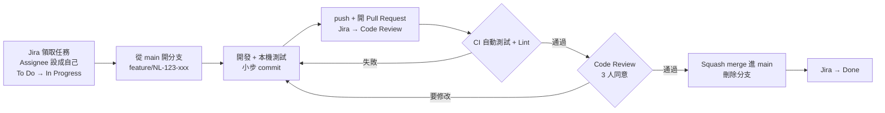

# 開發流程規範

> 這份文件是團隊**之後開發時必須遵守的規則**。每個人在開始寫程式前都要讀過一次；規則有需要調整時，可在discord討論區發起討論，討論通過後才生效。

**總則**

- 本專案所有程式碼的智慧財產權歸屬**學校**，不屬於個人。
- 開發統一在支援版本控制的平台（**GitHub**）上進行，所有規則以此為前提。

---

## 0. 一張圖看懂整個流程



**最重要的規則：**

1. **不要直接 push 到 `main`**，所有變更都要透過 Pull Request。
2. **每個分支、commit、PR 都要帶 Jira 編號**（例如 `NL-123`）。
3. **合併前一定要有 3 個人 review 並同意（Approve），且自動化檢查（CI）要全部通過**。
4. **新功能開 Ticket 前先跟指導教授與團隊討論過**，不要自己想到就直接做。

> 本專案的 Jira key 是 `NL`，任務編號格式為 `NL-123`。文件中的編號都是範例。

**三個工具各管什麼：**

| 工具 | 放什麼 |
| --- | --- |
| **Jira** | 任務本身：要做什麼、完成條件、誰負責、進度狀態，以及**從 Discord 同步過來的討論結果** |
| **Discord** | 討論：每個 Ticket 的討論開一個討論串（標題帶 `NL-123`），以及問問題、回報卡關、通知大家 |
| **GitHub PR** | 針對程式碼的 review 意見 |

---

## 1. Jira Ticket 管理

**Ticket 類型**

| 類型 | 什麼時候用 | 範例 |
| --- | --- | --- |
| **Task** | **所有要做的工作**：新功能、改善、重構、文件、工具設定都用 Task | 學生可以收回已繳交的作業、建立共用元件、導入 Vitest、更新文件 |
| **Bug** | 原本應該正常，但壞掉了 | 過了截止時間還能繳交作業 |
| **Sub-task** | 把一個 Task 拆成更小的工作 | 後端 API、前端頁面 |

> **Task 和 Sub-task 的差別**：Task 是一個**獨立的 Ticket**，可以單獨開分支、單獨合併；Sub-task 是**同一個 Ticket 拆出來的步驟**，通常跟著那個 Ticket 一起完成。

> ⚠️ **新功能開 Ticket 前，要先和指導教授與團隊討論過需求**，確認要做、怎麼做之後才開 Task Ticket、開分支動工。不是自己想到就直接做；非功能性的事（重構、工具導入、文件）不需要教授確認，但一樣要開 Ticket 並讓團隊知道。

### 1.1 開 Ticket

1. 在看板 **To Do** 欄位下方按 **「+」**，輸入標題後按 Enter。
2. 點開剛建立的 Ticket，補上下面的欄位。

| 欄位 | 填什麼 |
| --- | --- |
| **類型** | Task / Bug / Sub-task（見上方 Ticket 類型） |
| **標題** | 清楚寫出是哪個功能、要做什麼，例如「作業收回功能」「導入 Vitest」。不要只寫「作業頁」「修 bug」這種看不出內容的標題 |
| **Description** | 依類型照下方範本寫 |
| **Assignee** | 誰負責做。開 Ticket 時**還沒決定誰做就留空**，Ticket 會留在 To Do 等人認領；確定是自己要做的，就直接設成自己 |
| 其他 | Priority、Labels 有需要再填 |

**Task 的 Description 範本**

```markdown
## 背景
為什麼要做、使用者怎麼用。

## 完成條件
- [ ] 截止前可以收回作業
- [ ] 截止後無法收回，直接呼叫 API 也會被拒絕

## 技術備註（牽涉資料庫或 API 時才寫）
- API：DELETE /api/homeworks/:hwId/submissions/me
```

**完成條件一定要寫**，每一條都要能明確判斷「做到了沒有」。

**Bug 的 Description 範本**

```markdown
## 重現步驟
1. 用學生帳號登入
2. 打開已截止的作業
3. 按「繳交」

## 預期結果
跳出「已超過截止時間」，無法繳交

## 實際結果
繳交成功

## 環境
角色：學生 / 瀏覽器：Chrome
（截圖或錯誤訊息直接貼在 Ticket 附件）
```

Bug 修好的標準就是：**照重現步驟操作，會得到預期結果**。

一個 Ticket 最好在 **1～3 天內**能做完，太大就拆成 Sub-task 或多個 Ticket。

### 1.2 依照進度拖曳 Ticket

開始做、開 PR、合併時，把 Ticket **拖曳**到對應的欄位：

| 欄位 | 什麼時候拖過去 | 對應的 Git 動作 |
| --- | --- | --- |
| **To Do** | 開 Ticket | — |
| **In Progress** | 開始動手的那一刻 | 開分支 |
| **Code Review** | PR 開好、等人 review | 開 Pull Request |
| **Done** | PR 合併進 `main` 之後 | Merge |

- **認領 Ticket**：要做 To Do 裡沒有 Assignee 的 Ticket 時，先把 Assignee 設成自己，再拖到 In Progress。**拖到 In Progress 前，Assignee 一定要是自己**，大家才知道這個 Ticket 有人在做，不會重複做。
- 一個人手上的 In Progress **最好不超過 2 張**。
- 卡住超過一天，在 Discord 開討論串（標題帶 Ticket 編號）說明卡在哪裡。
- 開發途中發現的新問題，**另外開一個 Ticket**，不要塞進目前的分支。

### 1.3 在 Discord 開討論串討論，討論完同步寫到 Jira

Jira 主要用來放任務，討論都在 Discord 進行。但 Discord 的訊息很快就會被洗掉，事後很難找，所以某個 Ticket 需要討論時，照這三步做：

**① 在 Discord 開一個討論串，標題帶上 Jira 編號**

標題格式：`NL-123 要討論的問題`，例如：

> `NL-123 收回作業時要不要保留原本的檔案`

一個 Ticket 的討論都集中在同一個討論串裡，不要散在一般聊天中。

**② 在討論串裡討論**

**③ 討論完，由 Ticket 的 Assignee 同步寫到 Jira**

- 在 Jira Ticket 留一則簡短的留言，寫下**決定了什麼**，附上討論串連結：

  > 10/5 Discord 討論：收回作業時保留原本的答案和檔案，重新繳交時沒換檔就沿用舊檔。（討論串連結）

- 如果完成條件因此改變，**直接更新 Ticket 描述裡的完成條件**。
- 回到討論串回覆「已同步到 Jira」，讓大家知道這個討論結束了。

**哪些討論需要同步到 Jira？** 會影響「這個 Ticket 做出來的樣子」的才需要，例如改需求、改完成條件、決定資料表或 API 怎麼設計、決定某部分先不做。單純的問答（「`npm install` 失敗怎麼辦」）不用同步。

**其他規則**

- **新需求或 bug**：Discord 上提到的新需求或 bug，由提出的人（或是參與討論者）開成 Jira Ticket。
- **程式碼細節留在 PR**：針對某一行程式的意見，直接在 GitHub PR 上留言，比較好對照是哪一段程式。在 Discord 討論出結果的話，也要同步回 PR 留言。

判斷原則：**半年後有人問「為什麼這樣做」時，只看 Jira 和 PR 就要能找到答案。**

### 1.4 Jira 和 GitHub 的連結(尚未連結)

只要分支名稱、commit 訊息或 PR 標題裡有 Jira 編號（例如 `NL-123`），而且 Jira 已安裝 GitHub 整合，Ticket 上就會自動出現相關的分支、commit 和 PR。所以**一定要帶編號**，之後才查得到「這段程式是為了哪個 Ticket 寫的」。

---

## 2. Git 使用說明

### 2.1 第一次設定（每台電腦做一次）

```sh
# 設定名字與 email（請用和 GitHub 帳號相同的 email）
git config --global user.name "你的名字"
git config --global user.email "you@example.com"

# 下載專案
git clone https://github.com/Chrubby/eeclass.git
cd eeclass
```

**建立自己的環境設定檔（不會被 commit）**：指令依作業系統不同，複製貼上對應的那一段就好。

```sh
# macOS / Linux，或 Windows 的 Git Bash
cp backend/.env.example backend/.env
cp frontend/.env.example frontend/.env
```

```powershell
# Windows PowerShell 或 cmd
copy backend\.env.example backend\.env
copy frontend\.env.example frontend\.env
```

### 2.2 分支規則

| 分支 | 用途 | 誰可以直接 push |
| --- | --- | --- |
| `main` | 隨時都是**可以正常執行**的版本 | **沒有人**，只能透過 PR 合併 |
| 工作分支 | 每個 Jira Ticket 一個分支，做完就刪 | 自己 |

**工作分支命名**：`類型/Jira編號-簡短英文描述`

| 類型 | 用途 | 範例 |
| --- | --- | --- |
| `feature/` | 新功能 | `feature/NL-123-homework-unsubmit` |
| `fix/` | 修 bug | `fix/NL-130-deadline-check` |
| `refactor/` | 重構，不改變功能 | `refactor/NL-141-split-app-js` |
| `docs/` | 只改文件 | `docs/NL-150-api-docs` |
| `chore/` | 套件、設定、工具 | `chore/NL-155-add-vitest` |

描述用英文小寫、單字之間用 `-` 連接，不要用中文或空白。

### 2.3 每天的開發流程

**① 開始一個新 Ticket：從最新的 `main` 開分支**

```sh
git switch main
git pull                                        # 先拿到最新的 main
git switch -c feature/NL-123-homework-unsubmit # 開新分支並切過去
```

**② 開發中：小步 commit**

```sh
git status                    # 看改了哪些檔案
git diff                      # 看改了什麼內容
git add backend/src/services/homeworkService.js frontend/src/views/course/student/HomeworkStudent.vue
git commit -m "feat(homework): 學生可以收回已繳交的作業 NL-123"
```

- 一個 commit 只做**一件事**，做完一個小段落就 commit，不要整天只 commit 一次。
- `git add` 請**指定檔案**，避免用 `git add .` 把不相關的東西一起加進去。
- commit 前先看一次 `git diff`，確認沒有留下 `console.log`、測試用的程式碼。

**③ 推上 GitHub**

```sh
git push -u origin feature/NL-123-homework-unsubmit   # 第一次推這個分支
git push                                               # 之後只要這樣
```

**④ 開 Pull Request**：到 GitHub 頁面按「Compare & pull request」，規則見第 4 章。

**⑤ 合併後：清理**

```sh
git switch main
git pull
git branch -d feature/NL-123-homework-unsubmit   # 刪除本機分支
```

### 2.4 Commit 訊息格式

```
類型(模組): 一句話說明做了什麼 NL-123
```

| 類型 | 意思 |
| --- | --- |
| `feat` | 新功能 |
| `fix` | 修 bug |
| `refactor` | 重構，功能不變 |
| `test` | 新增或修改測試 |
| `docs` | 文件 |
| `style` | 排版、縮排，不影響邏輯 |
| `chore` | 套件、設定、建置工具 |

`模組` 使用 [modules/](modules/README.md) 的名稱：`auth`、`course`、`announcement`、`material`、`discussion`、`homework`、`homework-ai`、`course-ai`、`aiquiz`、`shared`、`db`。

**✅ 好的範例**

```
feat(homework): 學生可以收回已繳交的作業 NL-123
fix(aiquiz): 過了截止時間不能再送出答案 NL-130
docs(api): 補上作業 API 的 response 範例 NL-150
```

**❌ 不要這樣寫**

```
update            ← 看不出改了什麼
3.28              ← 日期不是說明
fix bug           ← 哪個 bug？
修改作業頁面        ← 沒有類型、沒有 Jira 編號
```

說明要寫「**做了什麼**」，需要解釋「**為什麼**」時，在第一行下面空一行再寫：

```sh
git commit -m "fix(homework): 收回作業時保留原本的檔案 NL-131" -m "原本收回會清空 file_path，學生重新繳交時要再上傳一次。"
```

### 2.5 讓分支跟上最新的 main

開發期間別人可能已經合併了新東西。**開 PR 前、或 PR 出現衝突時**，要先把最新的 `main` 合進自己的分支：

```sh
git switch main
git pull
git switch feature/NL-123-homework-unsubmit
git merge main
```

### 2.6 遇到衝突（conflict）怎麼辦

`git merge` 出現 `CONFLICT` 時：

1. 打開有衝突的檔案（VS Code 會標紅），會看到：
   ```
   <<<<<<< HEAD
   你的修改
   =======
   main 上別人的修改
   >>>>>>> main
   ```
2. 判斷要保留哪一段（或兩段合併），刪掉 `<<<<<<<`、`=======`、`>>>>>>>` 這三行標記。
3. 確認程式還能正常執行。
4. 完成合併：
   ```sh
   git add 有衝突的檔案
   git commit
   ```

**看不懂別人的修改時，不要猜，直接找那段程式的作者一起處理。**

### 2.7 常見狀況

| 狀況 | 指令 |
| --- | --- |
| 改到一半，想先切去別的分支 | `git stash` → 切分支做事 → 切回來 `git stash pop` |
| 想放棄某個檔案還沒 commit 的修改 | `git restore 檔名` |
| 已經 `git add`，想取消 | `git restore --staged 檔名` |
| 剛 commit 完發現訊息打錯（**還沒 push**） | `git commit --amend -m "新的訊息"` |
| 剛 commit 完發現漏了一個檔案（**還沒 push**） | `git add 漏掉的檔案` → `git commit --amend --no-edit` |
| 已經 push 的 commit 想撤銷 | `git revert <commit id>`（會產生一個新的 commit 抵銷它） |
| 不小心在 `main` 上改了東西（還沒 commit） | `git switch -c feature/NL-xxx-...`，修改會跟著帶到新分支 |

### 2.8 禁止事項

- ❌ 直接 push 到 `main`。
- ❌ `git push --force` 到 `main` 或別人的分支。自己的分支真的需要時，用 `git push --force-with-lease`。
- ❌ commit `.env`、密碼、API key、`node_modules/`、`backend/uploads/` 裡的檔案。
- ❌ 一個分支同時做好幾個 Ticket 的事。
- ❌ 用 `git add .` 之後沒檢查就直接 commit。

---

## 3. 開發規則

### 3.1 可讀性

- 變數、函式、檔案命名要讓人一看就懂在做什麼，不要用 `a`、`tmp`、`data2` 這種名字。
- 每個函式、類別、模組**只負責一件事**；一個函式做太多事時，拆成幾個小函式。
- 參考：[Code Readability](https://speakerdeck.com/munetoshi/code-readability)——開發前建議看一次。

### 3.2 註解

- 邏輯複雜、或用了不常見寫法的地方，要寫註解說明**為什麼**這樣寫（不是在重複程式碼本身在做什麼）。
- 自我檢查標準：如果 review 你程式碼的人看不懂這段在做什麼、為什麼這樣做，就該補註解。

### 3.3 AI 協作

- 可以用 AI（例如 Claude Code、ChatGPT）協助生成程式碼，**但你必須看懂每一行並為它負責**——PR 上是你的名字，不是 AI 的名字。
- AI 建議的外部套件（dependency）要自己確認：是不是主流、仍在維護的套件，版本是否還在官方支援週期內。AI 的知識有截斷日期（knowledge cutoff），也可能「幻覺」出不存在或已棄用的套件/API，不要照單全收。

### 3.4 程式架構

**後端**一律遵守分層，每一層只做自己的事：

| 層 | 放什麼 | 不能放什麼 |
| --- | --- | --- |
| Route | 路徑、`authMiddleware`、`requireRole` | 商業邏輯 |
| Controller | 讀 `req`、決定 HTTP 狀態碼、回傳 `res` | SQL |
| Service | 商業邏輯、transaction、組 AI 提示詞 | `req` / `res` |
| Model | SQL | 商業邏輯 |

- SQL 一律使用參數化查詢（`?`），**不准用字串拼接**。
- 呼叫 OpenAI 一律透過 `utils/openaiHelper.js`。
- 需要角色限制的 API 一定要掛 `requireRole(...)`；牽涉某門課的資料時，要檢查使用者是否屬於這門課。

**前端**

- 呼叫 API 一律使用 `@/api/client.js` 的 `api`。
- 前端隱藏按鈕只是畫面處理，**權限一定要在後端擋**。
- 顯示 AI 或使用者輸入的內容時，不要直接用 `v-html`；必須用時要先 sanitize。

新增一個完整功能時，需要改哪些檔案、各檔案的寫法，請照著現有模組的寫法做，詳見 [modules/](modules/README.md)。

### 3.5 資料庫變更

1. 在 Jira Ticket 寫清楚要新增 / 修改哪些資料表與欄位。
2. 修改寫在 `backend/scripts/initDB.js` **檔案最後**，用 `try/catch` 包起來，確保**可以重複執行**：
   ```js
   try {
       await pool.execute("ALTER TABLE homeworks ADD COLUMN allow_late TINYINT(1) NOT NULL DEFAULT 0");
   } catch (e) { /* 欄位已存在就忽略 */ }
   ```
3. **不要修改或刪除**已經存在的 `CREATE TABLE` 和 `ALTER TABLE`；欄位異動要照 **「先擴充、再切換、後刪除」** 的順序進行，不要一步到位直接改掉舊欄位：
   - **先擴充**：新增新欄位/新表，程式先同時讀寫新舊兩邊。
   - **再切換**：確認新的欄位/表運作正常後，把讀取邏輯全部切到新欄位。
   - **後刪除**：等到沒有任何版本的程式還依賴舊欄位（且已過可能回滾的觀察期），才真正刪除舊欄位。
   - 這樣即使部署後要回滾到前一版，也不會因為舊版程式找不到被改掉的欄位而壞掉（見 [4.4 部署「可回滾性」](#44-部署)）。
4. 存「課程」時用 `courses.id`（數字），存「使用者」時用 `accounts.id`（數字）。
5. 有關聯的欄位要加 `FOREIGN KEY`。
6. PR 加上 GitHub 標籤 **`db`**，PR 描述寫「需要執行 `node scripts/initDB.js`」。
7. 同步更新 [database.md](database.md)。

> ⚠️ **現況落差**：目前是用「疊加 `ALTER TABLE` 到同一支腳本」管理 schema，**不是正式的 migration 工具**（沒有版本編號、沒有自動 rollback）。現階段先照上面的規則做（尤其是「先擴充、再切換、後刪除」），之後團隊人數或變更頻率變高時，應評估導入正式的 migration 工具（例如 Knex migrations），讓每次變更都是獨立、可追蹤、可回滾的檔案。

**合併之後，資料庫要在兩個地方更新：**

| 哪裡 | 誰負責 | 什麼時候 |
| --- | --- | --- |
| **大家自己電腦的資料庫** | 每個人自己 | PR 合併後，提出者在 Discord 提醒「`main` 有資料庫變更」，大家下次 `git pull` 後執行 `node scripts/initDB.js` |
| **正式環境的資料庫** | 負責部署的人 | **下一次部署時**執行，見 [4.4 部署](#44-部署) |

不是每次合併都會馬上部署，所以正式環境不在合併當下更新，而是在部署流程裡固定執行一次。

### 3.6 API 變更

- 新增或修改 API 時，同步更新對應模組文件的「APIs」段落（格式見 [modules/README.md](modules/README.md#怎麼看-apis-段落)）。
- 成功回應：`{ "message": "...", "data": ... }`；錯誤回應：`{ "message": "錯誤原因" }`。
- 狀態碼：`400` 輸入錯誤、`401` 沒登入、`403` 沒權限、`404` 找不到、`500` 伺服器錯誤。
- 要修改已經有前端在用的 API 格式時，前後端要**在同一個 PR 一起改**，或先在 Discord 討論好，並同步寫到 Jira Ticket。

### 3.7 環境變數與機密

- 新增環境變數時，**同時加到 `.env.example`**，並寫註解說明用途與預設值。
- 密碼、API key、`JWT_SECRET` **只能放在 `.env`**，不能寫在程式碼裡，也不能貼在 Jira、PR 或 Discord。
- 不小心 commit 了機密：**馬上通知組長並更換該密碼 / key**。只刪掉檔案是不夠的，git 歷史裡還會留著。

### 3.8 測試(目前沒有自動化測試，規則先立好)

- **開 Ticket / 動工前先想好怎麼測**：Task Ticket 的「完成條件」就是測試的依據，寫 Task Ticket 時順便想一下這條功能要怎麼驗證，不要等寫完程式才想測試怎麼做。
- 修改 **Service 的邏輯**時，要新增或更新對應的單元測試（Vitest，放在 `backend/tests/`），盡量每個新功能都附上。
- 測試案例用 **Given-When-Then**（Gherkin 風格）描述，寫在測試檔的註解或測試描述裡，例如：

  ```js
  // Given 作業已過截止時間
  // When 學生呼叫收回 API
  // Then 回應 400，且繳交紀錄不變
  ```

- 修 bug 時，**先寫一個能重現 bug 的測試**，再修到它通過，確保這個問題以後不會又悄悄復發。
- 測試裡**不要連真的資料庫、不要呼叫真的 OpenAI**，用 `vi.mock` 換成假資料。
- **回歸測試**：新增/修改功能後，除了測自己改的部分，也要跑一次既有測試（`npm test`）確認沒有把其他功能改壞；沒有自動化測試覆蓋到的既有功能，PR 描述裡要寫清楚「這次改動可能影響到的其他功能，已手動確認過還能正常運作」。
- 開 PR 前，自己在本機跑過：
  - `npm test`
  - `npm run lint`（frontend）
  - 用相關的角色（學生 / 助教 / 老師）實際操作一次修改的功能

---

## 4. Pull Request、Code Review 與部署

### 4.1 開 PR 的規則

- **標題**：`[NL-123] 學生可以收回已繳交的作業`
- **大小**：盡量控制在 **400 行以內**的修改。太大的 PR 很難 review，請拆成多個。
- **還沒做完但想先讓人看**：開成 **Draft PR**。
- 描述請照下面的範本填寫：

```markdown
## Jira
NL-123

## 做了什麼
- 學生在截止前可以收回作業
- 收回後保留原本的答案和檔案

## 怎麼測試
1. 用學生帳號繳交作業
2. 按「收回」，確認狀態變成未繳交，答案還在
3. 把截止時間改成過去，確認「收回」按鈕消失，直接呼叫 API 也會回 400

## 截圖（有改畫面時）

## 檢查清單
- [ ] 有 Jira 編號
- [ ] 本機跑過 npm test、npm run lint
- [ ] 用相關角色實際操作過
- [ ] 有改資料庫 → 已更新 initDB.js 和 database.md
- [ ] 有改 API → 已更新 modules/ 文件
- [ ] 有新增環境變數 → 已更新 .env.example
- [ ] 沒有 commit 機密、沒有留下除錯用的 console.log
```

### 4.2 Review 的規則

**提出 PR 的人**

- **不用指定 reviewer**。PR 開好後在 Discord 貼上連結，請大家幫忙 review，**任意 3 個人 Approve** 就可以合併（不包含自己）。
- 收到意見後，修改並 push 到同一個分支，再回覆該則留言「已修改」。
- **Approve 之後又 push 了新的修改**，已經 Approve 的人要再看一次新改的部分（GitHub 會自動取消舊的 Approve，見 4.3）。所以請盡量把意見一次改完再 push，不要改一點推一點。
- 不同意某個意見時，在 PR 留言說明理由，不要直接忽略。講不清楚可以到 Discord 討論，討論完同步回 PR 留言。

**負責 review 的人**

- 看到 Discord 上的 PR 連結，請在 **1 個工作天內**去 review。每個 reviewer 都要**各自**看完整個 PR，不要分工只看一部分，也不要因為「別人應該會看」就隨便按 Approve。
- 看完後在 GitHub 選擇：**Approve**（可以合併）、**Request changes**（有必須改的地方），或只留 **Comment**（只有建議）。
- PR 超過 1 個工作天還沒湊滿 3 個 Approve，PR 提出者在 Discord 再提醒一次。
- 重點檢查：

| 項目 | 要問自己 |
| --- | --- |
| 功能 | 有沒有達成 Jira Ticket 的完成條件？ |
| 權限 | 新的 API 有沒有掛 `requireRole`？學生能不能看到 / 改到不該碰的資料？ |
| 資料庫 | SQL 是不是參數化？schema 變更有沒有寫進 `initDB.js`？ |
| 錯誤處理 | 出錯時使用者看到的訊息合理嗎？ |
| 機密 | 有沒有密碼、key 被寫進程式？ |
| 文件 | API / 資料表有改的話，文件有沒有跟著更新？ |

- 留言時說清楚是**必須改**還是**建議**，例如在建議前面加上 `nit:`（小建議，可以不改）。
- 針對程式，不針對人。

### 4.3 合併

- 條件：**3 人都 Approve**、**自動化檢查（CI）全部通過**，所有討論都已解決，沒有衝突。
- 由**提出 PR 的人**按合併。
- 合併方式：**Squash and merge**。把整個 PR 壓成一個 commit，訊息改成符合第 2.4 節的格式。
- 合併後**刪除遠端分支**（GitHub 按鈕），並把 Jira Ticket 移到 Done。

**自動化品質閘門（CI）**：每個 PR 開啟或更新時，GitHub Actions 自動執行：

- `backend`/`frontend` 的 `npm test`（單元測試）
- `frontend` 的 `npm run lint`（oxlint + eslint）

全部通過才算「checks passed」；**只要有一項失敗，就不能合併**，不是「人工確認自己跑過就好」。這一條是補上原本只靠 PR checklist 自我勾選、沒有自動擋下來的漏洞。

> ⚠️ **現況落差**：目前還沒有建立對應的 GitHub Actions workflow 檔案（`.github/workflows/`），上面這條規則是**之後要補上 CI 設定檔才會真正生效**的目標狀態；在補上之前，PR checklist 裡的「本機跑過 `npm test`、`npm run lint`」仍是唯一的把關方式，review 的人要確實檢查這兩項勾選框有沒有被誠實勾選。

**GitHub 設定**（repo 管理員設定一次）：Settings → Branches → 新增 `main` 的保護規則，勾選：

| 設定 | 值 |
| --- | --- |
| Require a pull request before merging | ✅ |
| Required number of approvals before merging | **3** |
| Dismiss stale pull request approvals when new commits are pushed | ✅（push 新修改後，舊的 Approve 失效，要重新 Approve） |
| Require conversation resolution before merging | ✅（所有留言討論都要標記已解決） |
| Require status checks to pass before merging | ✅（勾選 CI 的測試/lint workflow——**需要先建好 GitHub Actions 才有東西可勾**，見上方現況落差） |

設定之後，沒有滿 3 個 Approve、或 CI 沒過，GitHub 的合併按鈕就按不下去。

---

### 4.4 部署

合併進 `main` 不代表馬上上線，部署是另外進行的，可能累積好幾個 PR 才部署一次。每次部署照這個清單做：

1. **確認這次要部署哪些內容**：對照上次部署公告的 commit，看這段期間合併了什麼：`git log --oneline <上次的 commit>..origin/main`。
2. 在伺服器上拿到最新的 `main`：`git pull`
3. 安裝套件：`backend/`、`frontend/` 各執行一次 `npm install`
4. **更新資料庫：`cd backend && node scripts/initDB.js`**
   - **每次部署都執行**，不用判斷這次有沒有資料庫變更。`initDB.js` 可以重複執行，沒有變更時什麼都不會發生，這樣就不會漏掉。
5. 建置前端：`cd frontend && npm run build`
6. 重新啟動後端。
7. **部署後檢查**：登入、打開一門課程、打開作業頁，確認正常。
8. 在 Discord 公告**這次部署到哪個 commit**，用 `git log -1 --oneline` 查，例如「已部署到 `a1b2c3d`」。下次部署就從這個 commit 開始比對。

**有新的環境變數時**：部署前先確認伺服器的 `.env` 已經加上（新增的變數會寫在 `.env.example`，見 3.7）。

**分支策略**：本專案採用主幹式開發（[Trunk Based Development](https://trunkbaseddevelopment.com/)）——平時所有 PR 都合併進 `main`，部署時直接從 `main` 的最新狀態部署(目前**沒有另外開 release 分支**)。

**版號**：每次部署完成，在部署當下的 commit 上打一個 [語意化版本](https://semver.org/) tag，格式 `vMAJOR.MINOR.PATCH`（例如 `v1.3.0`），取代原本只記 commit hash 的做法：

```sh
git tag v1.3.0
git push origin v1.3.0
```

- PATCH（`v1.3.1`）：bug 修復。
- MINOR（`v1.4.0`）：新增功能，但不影響既有功能的使用方式。
- MAJOR（`v2.0.0`）：有不相容的重大改動（例如 API 格式大改）。

**產物特性**：發布的產物應具備 **不可變（immutable）且自包含（self-contained）** 的特性——正式的做法是由 pipeline 自動把每次部署編譯成獨立的產物（例如 Docker image），部署就是換一個新的 image 啟動，不會在伺服器上原地修改。

**目前的落差**：現在還沒有做到這件事——現在的部署方式是直接在伺服器上 `git pull` + `npm install` + `npm run build` + 重啟，等同於在正式環境原地修補。這是已知的技術債（另見 [process-issues.md](process-issues.md) 的部署章節），後續應導入 Dockerfile + CI 自動建置 image；在導入之前，**嚴禁手動在伺服器上改程式碼或裝套件**，來源一律是 `git pull`，避免伺服器狀態跟 `main` 的程式碼對不起來。

**網路暴露**：伺服器防火牆只開放必要的對外 port——`80`/`443`（HTTP/HTTPS）。 **MySQL 的 port（預設 `3306`）絕對不能對外網開放**，只能讓後端的伺服器內部連線。部署或換伺服器時務必確認這點。

**可回滾性**：任何時候都要能回滾到上一個「功能正常」的版本。目前沒有容器化，回滾方式是：

```sh
git fetch --tags
git log --oneline          # 找到上一個正常的 tag，例如 v1.2.0
git checkout v1.2.0
cd backend && npm install && cd ../frontend && npm install && npm run build
# 重新啟動後端
```

若那次回滾牽涉資料庫欄位異動，必須符合 [3.5 資料庫變更](#35-資料庫變更)的「先擴充、再切換、後刪除」原則，否則回滾後舊版程式可能因為欄位已經被刪除而壞掉——這也是為什麼刪除舊欄位前要先確認「沒有任何版本的程式還依賴它」。

---

## 5. 完成的定義（Definition of Done）

一個 Jira Ticket 要**全部**符合以下條件，才能移到 Done：

- [ ] 符合 Ticket 上的所有完成條件
- [ ] PR 已有 3 人 Approve、CI 檢查通過，並合併進 `main`
- [ ] 相關測試已新增並通過，且確認沒有改壞既有功能（回歸測試）
- [ ] 用相關角色實際操作過，功能正常
- [ ] 文件已更新（API、資料表、模組說明）
- [ ] 有資料庫變更時，PR 已加上 `db` 標籤，並已在 Discord 提醒大家更新本機資料庫
- [ ] Discord 上討論出的決定，已同步寫到 Jira Ticket
- [ ] 分支已刪除

---

## 6. 速查表

```sh
# 開始一個新 Ticket
git switch main && git pull
git switch -c feature/NL-123-short-name

# 開發中
git status
git diff
git add 檔案
git commit -m "feat(模組): 說明 NL-123"
git push -u origin feature/NL-123-short-name

# 跟上最新的 main
git switch main && git pull
git switch feature/NL-123-short-name
git merge main

# 合併後清理
git switch main && git pull
git branch -d feature/NL-123-short-name
```

| 東西 | 格式 |
| --- | --- |
| 分支 | `feature/NL-123-short-name` |
| Commit | `feat(homework): 說明 NL-123` |
| PR 標題 | `[NL-123] 說明` |
| Jira 狀態 | To Do → In Progress（Assignee 設成自己、開分支）→ Code Review（開 PR）→ Done（合併） |

## 代辦事項

這份文件裡有些規則目前還沒真的做到，先把標準寫在規則裡，但實際落差整理在這裡，之後要認領時照第 1 章開一張 Task Ticket：

* 把 GitHub、Jira 連接到 Discord
* Jira 跟 GitHub 的整合還沒安裝，分支/commit/PR 目前不會自動連回對應的 Ticket（見 1.4）
* 還沒有任何自動化測試，也還沒裝 Vitest（見 3.8）
* 還沒有 `.github/workflows/` 的 CI 設定檔，分支保護規則裡的「Require status checks to pass」目前還沒有東西可以勾（見 4.3）
* 資料庫 schema 變更目前只是把 `ALTER TABLE` 疊加寫進 `initDB.js`，不是有版本編號、可自動 rollback 的正式 migration 工具（見 3.5）
* 部署目前是直接在伺服器上 `git pull` + `npm install` + `npm run build` 原地部署，產物不是不可變、自包含的 Docker image（見 4.4）
* jira開code review階段
* jira開啟ticket類型(bug)
* 討論現階段PR如何進行(指定or隨機分配or有碰過該code的人、人數)